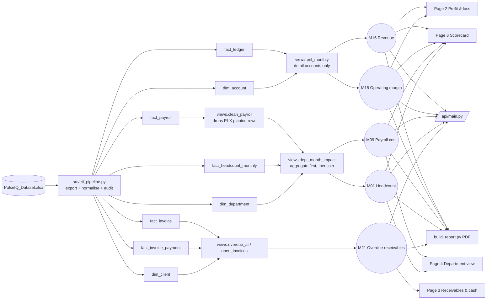

# Data lineage for the 5 API metrics (Task 19)

Each number can be followed from the raw workbook sheet to the page where it is shown.
The same functions in `src/views.py` feed the dashboard, the monthly PDF, the scorecard and the API,
so there is only one definition of each number.

| Metric | Raw sheet | ETL | Warehouse join | Metric view | Shown on |
|---|---|---|---|---|---|
| M16 Revenue | fact_ledger | etl_pipeline.py | fact_ledger ⋈ dim_account (is_group = N) | `pnl_monthly()` | P&L page, scorecard, PDF, API |
| M18 Operating margin | fact_ledger | etl_pipeline.py | fact_ledger ⋈ dim_account | `pnl_monthly()` | P&L page, scorecard, PDF, API |
| M09 Payroll cost | fact_payroll | etl_pipeline.py + `clean_payroll()` | fact_payroll ⋈ dim_department | `dept_month_impact()` | Department view, scorecard, PDF, API |
| M01 Headcount | fact_headcount_monthly | etl_pipeline.py | fact_headcount_monthly ⋈ dim_department | `dept_month_impact()` | People page, scorecard, PDF, API |
| M21 Overdue receivables | fact_invoice + fact_invoice_payment | etl_pipeline.py | fact_invoice ⋈ dim_client | `overdue_at()`, `open_invoices()` | Receivables page, PDF, API |

## If a column name changes in the raw feed, what breaks?

| Column renamed | Metrics that break |
|---|---|
| `fact_ledger.signed_amount_debit_positive` | M16 Revenue, M18 Operating margin (and the whole P&L page) |
| `fact_ledger.posting_period` | M16, M18 (no month), cash page |
| `dim_account.is_group` | M16, M18 — the group filter would fail (risk of double counting) |
| `fact_payroll.employer_cost` | M09 Payroll cost, cost per head, scorecard payroll vs budget |
| `fact_payroll.payroll_item_id` | M09 — planted rows could no longer be removed |
| `fact_headcount_monthly.headcount_end` | M01 Headcount, attrition, forecast back-test |
| `fact_invoice.balance_due` / `due_date` | M21 Overdue receivables, ageing |
| `fact_invoice_payment.amount` | M21 (history), cash receipts |

The test suite (`pytest -q`) fails loudly in all of these cases, which is the early warning.

## Freshness

The app, the PDF and the API all state: *Numbers cover Apr 2025 to Sep 2026. Source data is cut off at
30 Sep 2026*, plus the time the data files were last refreshed.
